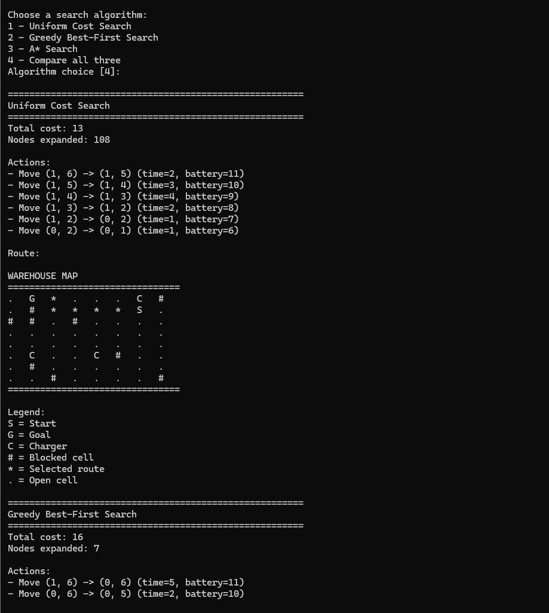

# Battery-Aware Warehouse Delivery Robot


## SOFE 3720 - Introduction to Artificial Intelligence


This project implements and evaluates a battery-aware route-planning agent in a simulated warehouse environment.


The robot must travel from a selected start location to a delivery goal while minimizing total travel time and never violating its battery constraint.


The warehouse contains:


- Blocked cells

- Charging stations

- Variable movement-time costs

- Limited battery capacity

- Four-directional movement


A route that appears geometrically short may not be feasible because of limited battery.


---


## Project Objective


The goal is to find the minimum-total-time feasible route from the start state to the goal state.


Total path cost includes:


- Movement time

- Charging time


The robot must maintain:


```text

battery >= 0

```

throughout the entire route.


## State Representation

Each search state is represented as:

(row, column, battery)


Battery level is part of the state because the same warehouse position can have different future possibilities depending on the remaining battery.

For example:

(2, 3, 1)


and:

(2, 3, 5)


represent different search states.

## Robot Actions

The robot supports the following actions:

Move Up

Move Down

Move Left

Move Right

Recharge


Movement is only allowed to open adjacent cells.

Each movement consumes:

1 battery unit


Charging is only available on charger cells.

A recharge restores the robot to full battery capacity.

Charging costs:

1 time unit per battery unit restored


## Movement-Time Costs

Warehouse movement is represented using weighted edges.

Each movement between adjacent cells has a travel-time cost.

Default generated movement costs are:

1 to 5 time units


Movement time and battery use are separate:

Battery use:

1 unit per move


Movement cost:

Variable edge travel time


# Search Algorithms

The project implements three search algorithms:

- Uniform Cost Search

- Greedy Best-First Search

- A* Search

## Uniform Cost Search

Uniform Cost Search expands the state with the lowest accumulated path cost.

Priority:

g(n)


UCS is used as the optimal-cost baseline for the experiments.

## Greedy Best-First Search

Greedy Best-First Search expands the state that appears closest to the goal according to the heuristic.

Priority:

h(n)


Greedy ignores the accumulated path cost when choosing which state to expand.

This often reduces search effort but may produce a higher-cost route.

## A* Search

A* combines accumulated path cost and estimated remaining cost.

Priority:

f(n) = g(n) + h(n)


where:

g(n) = movement time + charging time accumulated so far

h(n) = estimated remaining travel time


# Heuristic

The main heuristic is based on Manhattan distance:

h(n) =

Manhattan distance to goal

x

minimum movement-time edge cost


The heuristic ignores:

- Obstacles

- Battery limitations

- Charging delays

This makes it a lower-bound estimate of remaining movement time.

The project also evaluates:

h = 0

0.5 x Manhattan

Manhattan


to study how heuristic quality affects A* search effort.

# Warehouse Generation

The project includes a seeded random warehouse generator.

Generated warehouses can vary:

- Grid size

- Obstacle density

- Charger count

- Battery capacity

- Initial battery

- Movement-time range

- Start and goal positions

- Random seed

Using the same seed reproduces the same warehouse.

The generator supports two modes.

## Solvable Mode

ensure_solution=True


The generator retries until it creates a battery-feasible warehouse.

This is useful for demonstrations and controlled successful experiments.

## Unrestricted Mode

ensure_solution=False


The generated warehouse may be solvable or unsolvable.

This is used when studying how battery capacity and charger availability affect route feasibility.

# Visualization

The warehouse can be displayed directly in the terminal.

Symbols:

S = Start

G = Goal

C = Charger

-`#` = Blocked cell

* = Selected route

. = Open cell


Example:

S   *   *   .   .

.   #   *   #   .

.   C   *   *   G


# Experimental Evaluation

All algorithms are run on identical warehouse instances for fair comparison.

The following metrics are collected:

- Total solution cost

- Nodes expanded

- Execution time

- Success or failure

- Number of charging stops

- Number of movement actions

- Suboptimality ratio relative to UCS

The controlled experiments vary one factor at a time.

The project evaluates:

- Map size

- Obstacle density

- Movement-time cost distribution

- Battery capacity

- Charger availability

- Heuristic quality

- Start-to-goal distance

Most experiments use 20 seeded warehouse instances per setting.

# Preliminary Findings

The experiments show clear differences between the algorithms.

## UCS vs A*

A* consistently produces the same optimal solution cost as UCS while usually expanding fewer nodes.

In the 8x8 baseline experiment:

UCS

Average cost: 41.10

Average nodes expanded: 310.25


A*

Average cost: 41.10

Average nodes expanded: 264.10


This shows that the heuristic reduces search effort while preserving optimal solution quality.

## Greedy Best-First Search

Greedy generally explores far fewer states but may return more expensive solutions.

Baseline result:

Greedy

Average cost: 57.55

Average nodes expanded: 37.50


Compared with the UCS optimal average cost:

41.10


This demonstrates the trade-off between computational effort and solution quality.

## Battery Capacity

Battery capacity strongly affects route feasibility.

Example success rates:

Capacity 6:

10 / 20 successful


Capacity 8:

14 / 20 successful


Capacity 10:

16 / 20 successful


Capacity 12:

17 / 20 successful


Capacity 16:

18 / 20 successful


## Charger Availability

Charger availability also strongly affects feasibility.

Example:

0 chargers:

0 / 20 successful


1 charger:

15 / 20 successful


5 chargers:

18 / 20 successful


## Heuristic Quality

All tested admissible heuristic variants produced the same optimal average solution cost.

However, stronger heuristics reduced node expansion.

h = 0

Average nodes: 310.25


0.5 x Manhattan

Average nodes: 287.75


Manhattan

Average nodes: 264.10


## Start-to-Goal Distance

Search effort increases as the goal becomes farther from the start.

For UCS:

Distance 3:

13.95 average nodes


Distance 7:

168.45 average nodes


Distance 11:

207.70 average nodes


Distance 14:

348.95 average nodes


A* follows the same trend while generally expanding fewer states than UCS.

# Project Structure

battery-aware-warehouse-robot/

│

├── main.py

├── config.py

├── requirements.txt

│

├── warehouse/

│   ├── grid.py

│   ├── state.py

│   └── generator.py

│

├── search/

│   ├── ucs.py

│   ├── greedy.py

│   ├── astar.py

│   └── heuristics.py

│

├── visualization/

│   └── display.py

│

├── experiments/

│   ├── metrics.py

│   ├── runner.py

│   ├── suite.py

│   ├── heuristic_experiment.py

│   ├── distance_experiment.py

│   └── charts.py

│

├── maps/

│   └── test_maps.py

│

├── tests/

│   ├── test_warehouse.py

│   ├── test_ucs.py

│   ├── test_greedy.py

│   ├── test_astar.py

│   └── test_experiments.py

│

└── results/

&#x20;   ├── CSV experiment results

&#x20;   └── charts/


# Running the Project

Install the required plotting dependency:

pip install -r requirements.txt


Run the warehouse demonstration:

python main.py


# Running Tests

Run the warehouse tests:

python -m tests.test_warehouse


Run UCS tests:

python -m tests.test_ucs


Run Greedy tests:

python -m tests.test_greedy


Run A* tests:

python -m tests.test_astar


Run experiment tests:

python -m tests.test_experiments


# Running Experiments

Run the baseline experiment:

python -m experiments.runner


Run the complete controlled experiment suite:

python -m experiments.suite


Run the heuristic experiment:

python -m experiments.heuristic_experiment


Run the start-to-goal distance experiment:

python -m experiments.distance_experiment


Generate result charts:

python -m experiments.charts


# Results

Experiment CSV files are stored in:

results/


Generated charts are stored in:

results/charts/

## Final Analysis

### A* Compared with Uniform Cost Search

A* and UCS produced the same average optimal solution cost in the baseline experiments, but A* generally expanded fewer states.

In the 8x8 baseline:

- UCS average cost: 41.10
- UCS average nodes expanded: 310.25
- A* average cost: 41.10
- A* average nodes expanded: 264.10

This shows that A* preserved the solution quality of UCS while reducing the amount of search required.

### Effect of the Heuristic

The heuristic reduces search effort by guiding A* toward states that appear closer to the goal.

With h = 0, A* behaves like UCS and expanded an average of 310.25 states.

Using a weaker heuristic reduced this to 287.75 states, while the full Manhattan-based heuristic reduced it further to 264.10 states.

The solution cost remained unchanged, showing that a stronger admissible heuristic improved search efficiency without sacrificing optimality.

### Greedy Best-First Search Trade-Off

Greedy Best-First Search expanded far fewer states because it considers only the heuristic estimate h(n).

In the baseline:

- Greedy average nodes expanded: 37.50
- Greedy average cost: 57.55
- UCS optimal average cost: 41.10

This demonstrates the trade-off between computational effort and solution quality. Greedy can find a route using much less search, but it may choose a more expensive route because it ignores the accumulated path cost.

### Conditions Affecting Algorithm Performance

UCS performs reliably when an optimal solution is required, but it may explore many states because it has no heuristic guidance.

A* performs well when the heuristic provides useful guidance. It typically expands fewer states than UCS while maintaining optimal solution quality.

Greedy performs well when reducing search effort is more important than guaranteeing the lowest-cost route. It can perform poorly when the most direct-looking route has expensive movement costs or when battery and charging constraints make a different route more suitable.

Larger maps and longer start-to-goal distances generally increase the number of states explored.

Battery capacity and charger availability mainly affect whether a feasible route exists. Lower battery capacity and fewer chargers produced more failed runs.

### Main Trade-Off

The main trade-off observed in the project is between solution quality and search effort.

- UCS prioritizes optimality but may perform more search.
- Greedy minimizes search effort but may sacrifice solution quality.
- A* provides the best balance in our experiments by using both accumulated path cost and heuristic guidance.


# Current Limitations

The current system uses:

- One robot

- One delivery goal

- A known static warehouse

- Four-directional movement

- Whole-number battery levels

- Full recharge at charging stations

The project does not currently include:

- Dynamic obstacles

- Multiple robots

- Partial charging decisions

- Unknown environments

- Real-world robot hardware

These limitations keep the project focused on controlled comparison of the required AI search algorithms.

## Representative Failure Cases

### Insufficient Battery and Charger Access

A warehouse may contain a geometric path from the start to the goal but still have no battery-feasible solution.

For example, if the robot cannot reach a charging station before its battery reaches zero, the search correctly reports failure even though open grid cells connect the start and goal.

This is why battery level is included directly in the search state.

### Greedy Best-First Search Can Choose an Expensive Route

Greedy Best-First Search chooses states using only the heuristic estimate to the goal.

A route that appears geometrically closer to the goal may contain high movement-time edge costs. Greedy can therefore reach the goal using fewer node expansions while producing a more expensive route than UCS or A*.

The baseline experiments demonstrate this behaviour:

- UCS average cost: 41.10
- A* average cost: 41.10
- Greedy average cost: 57.55

### Resource-Limited Unsolvable Maps

The unrestricted warehouse generator intentionally allows unsolvable instances.

These cases are useful when evaluating battery capacity and charger availability because failure rate is part of the experimental result rather than an error in the program.

# Course

SOFE 3720

Introduction to Artificial Intelligence

Battery-Aware Warehouse Delivery Robot

Group 7

## Demo

The program displays the warehouse, selected route, and algorithm comparison directly in the terminal.



### Charging-Required Scenario

Run the interactive program:

```bash
python main.py
```

Select:

```text
3 - Charging-required test map
```

This predefined scenario requires the robot to use a charging station in order to successfully reach the goal. It provides a simple demonstration that battery state and charging behaviour are integrated into the search problem rather than being used only for experimental statistics.


